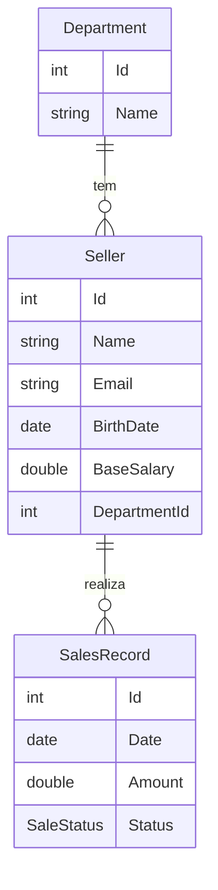

# SalesWebMVC

Aplicação web de gestão de vendas feita com **C#** e **ASP.NET Core MVC**. Ela cadastra departamentos e vendedores e consulta os registros de venda por período, inclusive agrupados por departamento.

Projeto de estudo, desenvolvido durante o curso de C# e ASP.NET Core MVC.

## Funcionalidades

- **Vendedores:** listar, cadastrar, ver detalhes, editar e excluir, com validação dos dados.
- **Departamentos:** CRUD completo.
- **Registros de venda:** consulta por intervalo de datas, de dois jeitos:
  - **Busca simples:** lista as vendas do período, da mais recente para a mais antiga.
  - **Busca agrupada:** mostra as vendas separadas por departamento, com o total vendido de cada um no período.
- **Dados de exemplo:** na primeira execução o banco recebe 4 departamentos, 6 vendedores e 30 registros de venda.

### Regras de validação do vendedor

| Campo | Regra |
| --- | --- |
| Nome | Obrigatório, de 3 a 60 caracteres |
| E-mail | Obrigatório e em formato válido |
| Data de nascimento | Obrigatória |
| Salário base | Obrigatório, entre 100 e 50.000 |

Cada venda tem um status: `Pending` (pendente), `Billed` (faturada) ou `Canceled` (cancelada).

## Tecnologias

- C# e ASP.NET Core MVC
- Entity Framework Core com migrations
- MySQL (provider Pomelo)
- Razor Views e Bootstrap (tema escuro)
- LINQ e programação assíncrona (`async`/`await`)

## Arquitetura

O projeto separa responsabilidades em camadas:

```
Controllers  →  Services  →  DbContext (EF Core)  →  MySQL
   (HTTP)     (regras e consultas)
```

- **Controllers** recebem as requisições e escolhem a view.
- **Services** concentram as consultas e operações de dados (`SellerService`, `DepartmentService`, `SalesRecordService`). Os serviços são registrados por injeção de dependência.
- **Exceções próprias** (`NotFoundException`, `IntegrityException`, `DbConcurrencyException`) tratam erros como registro não encontrado, falha de integridade ao excluir e conflito de concorrência ao editar.
- Os formulários usam `[ValidateAntiForgeryToken]` para proteção contra CSRF.

### Modelo de dados



## Estrutura de pastas

```
SalesWebMVC/
├── Controllers/     Departments, Sellers, SalesRecords e Home
├── Data/            DbContext e SeedingService (dados iniciais)
├── Migrations/      Histórico do banco (EF Core)
├── Models/          Department, Seller, SalesRecord e ViewModels
├── Services/        Consultas, regras e exceções próprias
├── Views/           Páginas Razor de cada controller
└── wwwroot/         CSS, JavaScript e bibliotecas
```

## Como rodar

**Pré-requisitos:** SDK do .NET compatível com o `TargetFramework` do projeto (veja o `.csproj`) e um servidor MySQL em execução.

1. Clone o repositório:

   ```bash
   git clone https://github.com/ArthurSGasparini/SalesWebMVC.git
   cd SalesWebMVC/SalesWebMVC
   ```

2. Informe a conexão com o banco **sem gravar a senha no código**. No PowerShell, use uma variável de ambiente:

   ```powershell
   $env:ConnectionStrings__SalesWebMVCContext = "server=localhost;userid=SEU_USUARIO;password=SUA_SENHA;database=saleswebmvcappdb"
   ```

3. Crie o banco e as tabelas:

   ```bash
   dotnet ef database update
   ```

4. Execute a aplicação:

   ```bash
   dotnet run
   ```

5. Abra `http://localhost:5137` no navegador (ou `https://localhost:7166`). Na primeira execução, os dados de exemplo são inseridos automaticamente.

> **Segurança:** nunca coloque senhas, tokens ou chaves de API no repositório. Use variáveis de ambiente ou `user-secrets`.

## Próximos passos

- [ ] Atualizar o projeto para uma versão atual do .NET
- [ ] Adicionar testes automatizados
- [ ] Containerizar a aplicação com Docker
- [ ] Criar pipeline de CI/CD com GitHub Actions
- [ ] Melhorar o visual das telas

## Autor

**Arthur Gasparini**, [GitHub](https://github.com/ArthurSGasparini)
